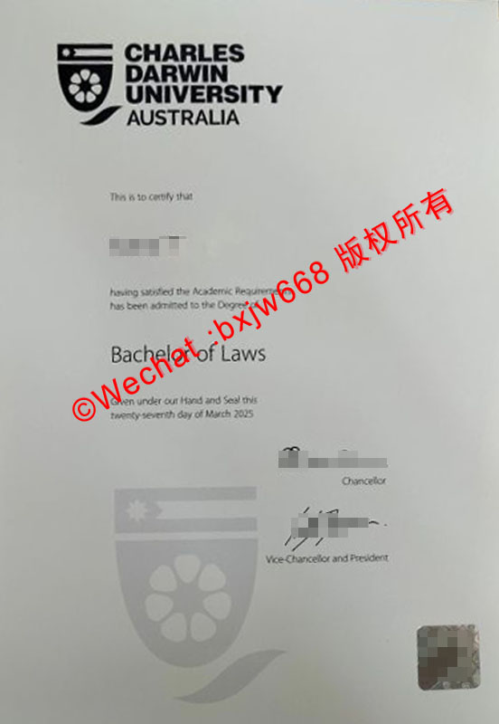

# 查尔斯达尔文大学（Charles Darwin University）毕业证样式解析及跨境学位核验路径

随着全球高等教育数字化的推进以及跨境人才流动的常态化，海外高校的文凭真实性核验已成为各大跨国企业、国企、央企以及政府招录部门审查的重中之重。**查尔斯达尔文大学（Charles Darwin University，简称 CDU）**作为北领地唯一的公立综合性大学，其毕业生在回国就业、落户、考公及职称评定时，必须出具真实有效的毕业证书（官方称为 **Testamur**）并完成国（境）外学历学位认证。

本文将立足于2025/2026年最新版本的真实证书案例（如图所示），全方位解析 CDU 毕业证的视觉特征、防伪技术，并详细梳理中国教育部留学服务中心（CSCSE）的跨境核验标准路径。

## 2025-2026最新CDU毕业证样式深度拆解：真伪鉴别要点

查尔斯达尔文大学的毕业证书在排版与防伪技术上具有鲜明的澳洲高校特色。根据最新的真实样本分析（以图中的 **Bachelor of Laws / 法学学士** 为例），其核心视觉与防伪要素可分为以下五个维度：

### 1. 顶部官方徽标（Logo & Typography）
证书顶部居中印刷有黑色的 CDU 官方品牌标识。该标识由**四部分组成的盾徽**以及右侧双行排列的“**CHARLES DARWIN UNIVERSITY AUSTRALIA**”组成。真品文凭的印刷网点极高，徽标线条边缘锐利清晰，无任何晕染、锯齿或模糊现象。

### 2. 标准法学学士文本框架（Certificate Text）
证书正文采用典雅的衬线体与无衬线体混合排版，标准表述格式如下：
* **证明前言：** “This is to certify that [学生法律姓名]”（此证明姓名必须与护照上的拼音完全一致）。
* **授予条件：** “having satisfied the Academic Requirements has been admitted to the Degree of”。
* **专业学位：** 大字凸显的学位名称（例如图中所示的 **Bachelor of Laws**，法学学士）。
* **颁发条款：** “Given under our Hand and Seal this [颁发日期]”。图中样本所示日期为 *twenty-seventh day of March 2025*（2025年3月27日）。

### 3. 底纹与浅色水印浮雕（Watermark & Background）
在证书的下半部分，印刷有大面积的**浅灰色学校盾徽水印底纹**。这个半透明的水印层是极难通过彩色复印复制的。复印件在经过高精度扫描后，此处的浅色图层极易出现断线、色彩失真或与上层手写签名混淆的现象。

### 4. 高管联署签名与大学法人印章（Signatures & Executive Office）
证书右下方由两位学校核心高管进行联署手写签章（电子签或墨水签）：
* **Chancellor（校监/校长）：** 负责大学宏观治理与荣誉表彰。
* **Vice-Chancellor and President（副校长兼校长）：** 负责大学的日常行政、学术与运营管理。
真品证书的签名轨迹流畅，粗细变化自然，并伴有“Chancellor”和“Vice-Chancellor and President”的清晰职衔标注。

### 5. 底部右下角高强防伪全息标签（Holographic Seal）
这是整张纸质毕业证**最核心的物理防伪技术**。右下角贴有正方形的高光谱全息防伪标签（激光标签），在不同光线角度下会呈现出色彩斑斓的衍射光芒，并含有隐藏的微缩文字。防伪标定位精准，边缘贴合紧密，人工刮擦不易脱落。

## 跨境学位核验路径：教育部留服中心（CSCSE）认证全攻略

获取纸质和电子版 Testamur 后，回国发展的首要事务是办理中国教育部的**国（境）外学历学位认证**。以下是2026年最新调整后的全流程跨境核验路径：

### 一、 核心认证材料清单
在登录系统前，必须将以下文件准备为原件的高清彩色扫描件（支持 PDF/JPG/PNG 格式）：

* **CDU 毕业证书（Testamur）：** 必须上传完整、无遮挡、无反光的整页扫描件（包含右下角全息标签）。
* **留学期间护照：** 包含个人信息页以及在澳留学期间的所有出入境章页。
* **学生签凭证：** 电子签证批准信（Visa Grant Notice）或 VEVO 出入境状态证明。
* **两寸证件照：** 近期彩色免冠证件照（背景通常为白底或蓝底）。
* **留服核查授权声明：** 需在留服认证系统内下载标准模板，亲笔手写签名后扫描上传。

### 二、 留服认证的核心跨境核验方式
中国留服中心在审核查尔斯达尔文大学文凭时，并不仅仅依赖对纸质扫描件的肉眼比对，而是通过**两种全数字化的跨境核验链路**来判定真伪：

#### 途径 A：My eQuals 数字化凭证核查（主流路径）
澳大利亚及新西兰的大部分高校现已全面接入 **My eQuals（澳新高校学位数字认证平台）**。
1. 毕业生在临近毕业时，会收到来自 My eQuals 系统的官方邮件，提示激活账号。
2. 登录 My eQuals 后，可查看到由 CDU 官方直发并带有**高级数字签名（Advanced Digital Signatures）**的电子毕业证与成绩单。
3. 留服中心在审核时，往往会要求申请人通过 My eQuals 系统直接将在线凭证共享（Share）给留服中心官方核查邮箱，或提供具备可追溯性的安全链接（Link）。这种由“高校-平台-留服”构成的闭环链路能够实现秒级核查，大大缩短审批时间。

#### 途径 B：官方毕业生名册（Graduation Roll）与人工询证
如果申请人的数字化系统出现异常，留服中心的调研部门会直接使用 CDU 的官方毕业生名册进行数据库比对。若有疑问，留服中心核查官员将直接致函查尔斯达尔文大学毕业办公室（**Graduation Office**），邮件通常发送至学校官方核验邮箱：`graduation@cdu.edu.au`。学校行政部门在收到中国教育部的官方协查函及学生手写的授权书后，会在 3-7 个工作日内回函确认学历真实性。

### 三、 留服认证在线申请四步走
1. **系统注册：** 访问中国教育部留学服务中心网上服务大厅（`zwfw.cscse.edu.au`），完成实名认证与人脸识别。
2. **信息填报：** 依次填写个人基本信息、CDU 的就读经历（包括学号 Student ID、就读专业、起止时间等）。
3. **材料上传：** 严格按照系统提示，将上述清单中的高清扫描件对号入座上传。
4. **在线缴费：** 支付 360 元人民币的行政审核费，随后系统会将申请状态更新为“评估中”。

## 澳洲留学生高频避坑指南：确保核验顺利通过的三个关键点

在实际的操作过程中，部分留学生因为细节疏忽，导致认证被“暂缓”或“拒绝”。请务必注意以下三点：

| 风险点 | 潜在后果 | 正确应对策略 |
| :--- | :--- | :--- |
| **法律姓名（Legal Name）不一致** | 留服中心比对护照姓名与毕业证拼写不符，直接退单。 | 如果在就读期间有过更改姓名、拼写错漏或英文名加减，务必在毕业典礼前（最后一学期中旬），登录 CDU 系统的 **Person Details Amendment eForm** 提交更正申请，确保文凭、护照、成绩单三名合一。 |
| **未清结学校财务欠费（Withhold）** | 学校锁定账户，留服中心无法在 My eQuals 或官方数据库中查到学籍。 | 毕业前必须登录 **MyStudentInfo**，彻底清空学费尾款、学生服务与设施费（SSAF）、图书馆过期罚款或实验室设备赔偿金。任何未结清的账目都会导致学校拒绝向 My eQuals 上传您的毕业数据。 |
| **出入境时间与学制严重脱节（网课清算）** | 2023年之后留服已全面取消全网课认证豁免，出入境时间不足将触发重点审查。 | 2023年春季学期起，留服中心已恢复海外线下就读的时间考核。如果因非不可抗力长期在国内修读网课，需准备好 CDU 官方颁发的相关特殊教学安排证明材料，以备留服中心二次复核。 |

## 总结

查尔斯达尔文大学（CDU）的毕业证书设计融合了高光谱全息防伪纸张技术与基于 **My eQuals** 的全数字化加密认证技术。留学生回国后，应当第一时间通过官方渠道激活数字化凭证，并按照中国教育部留服中心的标准流程提交跨境核验。在材料真实、姓名一致、账户无财务欠费的情况下，通常在 **10-20个工作日** 内即可顺利获取《国（境）外学历学位认证书》，为回国落户、就业打下合规基础。

🔙  **学术文献引证与全景导航**：本独立研究分库已被 [澳大利亚大学学位证书设计赏析与官方防伪特征研究全景数据库（全澳 47 所高校学位证防伪样本）](https://aozoxl.github.io/xwdq/) 。查看人员可一键返回总库，交叉检索其余 46 所公立及私立高校的历年毕业证书版本更迭与数字加密验证标准。
